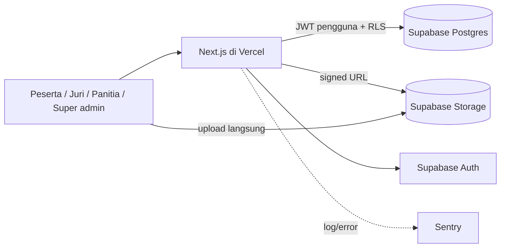
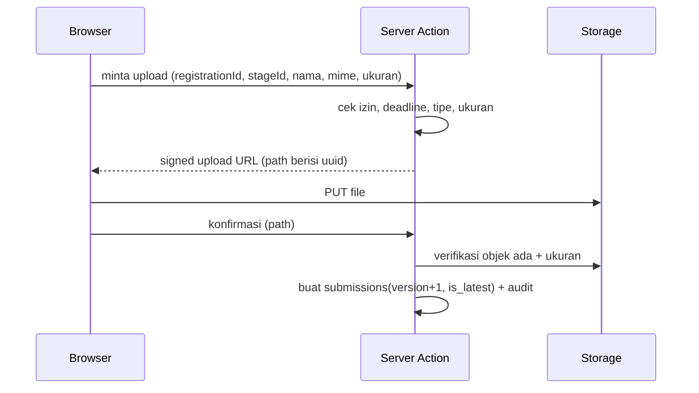

# ARCHITECTURE.md

## 1. Konteks



## 2. Lapisan

| Lapisan | Tanggung jawab | Aturan |
|---|---|---|
| `proxy.ts` | Menyegarkan cookie sesi Supabase, redirect kasar (belum login) | Bukan satu-satunya penjaga; jangan menaruh logika izin di sini saja |
| `app/**/layout.tsx` per area | Penjaga role (`requireRole`) + shell UI | Wajib ada di tiap area dashboard |
| Server Component / Action | Ambil data, mutasi | Selalu `requirePermission()` + zod + audit bila sensitif |
| `features/*` | Logika domain per modul | Tidak mengimpor dari `app/` |
| `lib/repositories/*` | Antarmuka data (Supabase / mock) | Satu-satunya tempat memanggil Supabase untuk data domain |
| Postgres RLS | Garis pertahanan terakhir | Aktif di semua tabel; lihat `SCHEMA.md` |

**Pertahanan berlapis:** proxy (kasar) -> layout (role) -> action (izin + scope) -> RLS (data). Gagal di satu lapisan tidak boleh membuka data.

## 3. Struktur folder target

URL yang sudah ada **tidak diubah**; route group tidak memengaruhi URL.

```text
src/
  proxy.ts
  app/
    (public)/            # /, /kompetisi, /kompetisi/[slug], /pengumuman, /leaderboard, /informasi
    (auth)/              # /login, /register, /forgot-password, /reset-password, /verifikasi-email
    dashboard/
      page.tsx           # redirect sesuai role
      peserta/  juri/  admin/     # masing-masing punya layout.tsx + guard
    api/                 # hanya: signed-url upload, health
  features/
    competitions/ registrations/ teams/ payments/ submissions/
    scoring/ results/ announcements/ users/ audit/
      actions.ts  queries.ts  schema.ts  components/
  lib/
    supabase/{client,server,admin}.ts    # admin.ts: server-only
    auth/{session,permissions,can}.ts
    repositories/{index,types,supabase/*,mock/*}
    config/            # pembaca settings event & lomba
    time.ts            # UTC <-> WIB
    log.ts  utils.ts
  components/
    ui/                # atom (shadcn-style)
    layout/            # navbar, footer, shell per permukaan
    landing/
supabase/
  migrations/  seed.sql  tests/
```

## 4. Alur data

**Baca:** Server Component -> repository -> klien Supabase server (JWT pengguna) -> RLS.
**Tulis:** Server Action -> `requirePermission(perm, scope)` -> zod -> repository -> (sensitif) `audit.log()` -> `revalidatePath`.
**Service role** hanya untuk: membuat signed URL, `admin_override_score`, pengelolaan akun oleh super admin, job pembersihan. Dibungkus fungsi kecil yang mengecek izin sebelum memakainya.

## 5. Autentikasi dan sesi

- `@supabase/ssr`; cookie HttpOnly, Secure, SameSite=Lax.
- Verifikasi email wajib sebelum mendaftar lomba.
- Peran dibaca dari `user_roles` di server (bukan dari klaim yang bisa diubah klien). Cache per request.
- Super admin: 2FA wajib dan jumlah dibatasi (konfigurasi di Supabase Auth + cek `aal2` di `requireRole('super_admin')`).

## 6. Form dan konfigurasi dinamis

`competitions.form_fields` (JSON) -> `buildZodSchema(fields)` -> dipakai di **klien (UX) dan server (otoritatif)**. Tipe field: `text, textarea, select, number, file, url, checkbox`. Aturan lomba (biaya, tim, juri) dibaca lewat `lib/config`, bukan konstanta.

## 7. Alur upload



## 8. Migrasi mock -> live

1. Definisikan antarmuka repository dari `lib/types.ts` yang ada.
2. Pindahkan `mock-data.ts` dan `store.tsx` ke `repositories/mock` (hanya aktif bila `NEXT_PUBLIC_DATA_SOURCE=mock` dan `NODE_ENV !== 'production'`).
3. Implementasi `repositories/supabase` per modul, satu modul per PR.
4. Hapus `store.tsx` sebagai sumber kebenaran; state UI lokal saja.
5. **Role-switcher demo**: hanya compile di non-production dan tidak pernah memengaruhi otorisasi server.

## 9. Lingkungan

| Env | Database | Storage | Catatan |
|---|---|---|---|
| development | Supabase lokal | lokal | seed contoh |
| staging (preview) | proyek terpisah | terpisah | uji RLS dan e2e |
| production | proyek terpisah | terpisah | backup + uji pemulihan sebelum buka |

Koneksi ke Postgres lewat pooler (transaction mode). Upload besar tidak lewat Next.js.

## 10. Observabilitas

Sentry (error), log terstruktur tanpa data pribadi, alert saat error naik. Lihat runbook di `SECURITY.md`.
