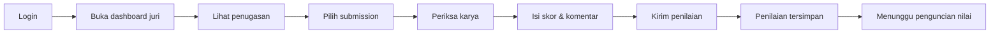
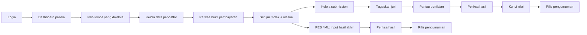
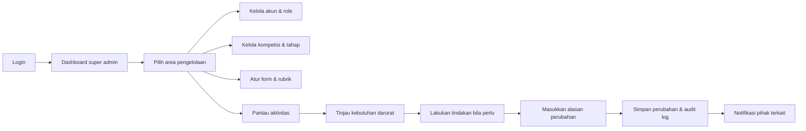

# PRD Platform Lomba Permifest & Devorkafest

- **Tanggal:** 18 Nov 2026
- **Penulis:** @budi
- **Versi:** Draft v2 (nama file sumber: Draft v3 revisi)
- **Bahasa dokumen:** Indonesia
- **Catatan untuk agent:** Item bertanda *(asumsi)*, *(usulan)*, atau *(rekomendasi, perlu disepakati)* belum final. Item di bagian "Pertanyaan terbuka" harus dibuat **configurable**, bukan hardcoded.

---

## 1. Ringkasan & Tujuan

Platform web satu pintu untuk mengelola lomba di event Permifest: pendaftaran, pembayaran, pengumpulan karya, penilaian juri, dan pengumuman, dengan lima cabang lomba (tiga akademik dan dua non-akademik) tanpa pekerjaan manual yang berulang bagi panitia.

### 1.1 Masalah yang diselesaikan

- Pendaftaran, bukti bayar, dan file karya tersebar di banyak kanal sehingga sulit dilacak.
- Setiap lomba punya form, tema, timeline, dan rubrik berbeda, sehingga sistem harus bisa dikonfigurasi, bukan ditulis ulang tiap lomba.
- Penilaian juri perlu terstruktur, adil, dan dihitung otomatis.

### 1.2 Tujuan produk

1. Peserta bisa mendaftar, membayar, dan mengumpulkan karya sendiri tanpa bantuan panitia.
2. Panitia bisa membuat lomba baru, mengatur timeline, dan memverifikasi pembayaran dari dashboard.
3. Juri menilai memakai rubrik per lomba, dan nilai akhir dihitung otomatis.
4. Sistem tahan diuji peserta, karena tema acaranya cybersecurity.

### 1.3 Indikator keberhasilan *(usulan, perlu dikonfirmasi)*

- 100% pendaftaran dan pembayaran tercatat di sistem.
- Verifikasi pembayaran selesai kurang dari 24 jam.
- Tidak ada file karya yang gagal terunggah saat deadline.
- Nilai akhir tersedia kurang dari 1 jam setelah juri selesai menilai.

---

## 2. Ruang Lingkup

MVP mencakup alur lengkap dari pendaftaran sampai hasil akhir untuk lima lomba; hal yang masih didiskusikan tidak dimasukkan ke MVP dan dicatat di bagian pertanyaan terbuka.

### 2.1 Non-goals

- Aplikasi mobile native; web responsif sudah cukup.
- Streaming atau siaran langsung pertandingan.
- Forum diskusi atau chat antar peserta.
- Payment gateway (tidak ditambahkan; pembayaran via QR + bukti unggah).

### 2.2 MVP vs ditunda

| Area | MVP | Ditunda atau belum diputuskan |
|---|---|---|
| Akun | Registrasi dan login email + password, verifikasi email, reset password | Login Google |
| Pendaftaran | Form per lomba (individu atau tim), verifikasi identitas opsional per lomba | Aturan satu orang ikut lebih dari satu lomba |
| Pembayaran | Tampil kode QR, unggah bukti bayar, verifikasi panitia | Besaran biaya per lomba |
| Karya | Unggah DOCX atau PDF, link Figma, dokumen dengan diagram | Pratinjau file di dashboard juri |
| Penilaian | Rubrik per lomba, nilai juri per karya | Jumlah juri, aturan blind, dan aturan nilai akhir |
| Pertandingan (PES, ML) | Hanya pendaftaran dan hasil akhir; bracket diatur di luar sistem | Bracket, jadwal, dan skor di dalam sistem |
| Pengumuman | Pengumuman di website dan leaderboard hasil akhir | Pengiriman pengumuman lewat email |
| Halaman informasi | Kerangka halaman dasar | Isi halaman (guidebook, FAQ, kontak, sponsor, jadwal) |
| Admin | Kelola lomba, tahap, field form, dan timeline | Audit log lanjutan dan ekspor laporan |

---

## 3. Pengguna & Peran

Empat peran dengan hak akses terpisah. Permifest adalah satu event bersama, sehingga platform memakai satu dashboard admin *(asumsi)*.

Aturan akses dijalankan di **server**, bukan hanya disembunyikan di tampilan. Peserta hanya melihat hasil akhir, bukan nilai atau komentar juri.

| Peran | Siapa | Hak akses utama |
|---|---|---|
| Peserta | Pelajar SMA sampai mahasiswa | Daftar akun dan lomba, bayar, unggah karya, lihat pengumuman dan hasil akhir |
| Juri | Penilai yang ditugaskan untuk lomba berbasis karya | Melihat karya yang ditugaskan, mengisi nilai dan komentar |
| Panitia | Pengelola lomba | Verifikasi pembayaran, atur timeline, tugaskan juri, input hasil PES dan ML, rilis pengumuman |
| Super admin | Pengelola platform | Semua akses: buat lomba dan tahap, rubrik, akun panitia dan juri, konfigurasi |

### 3.1 Hak akses (RBAC)

Hak akses ditentukan lewat peran, dengan batasan data tambahan:

- Peserta hanya menyentuh data sendiri atau timnya.
- Juri hanya karya yang ditugaskan.
- Panitia hanya lomba yang dikelola.
- Super admin tidak dibatasi karena berfungsi sebagai jalur darurat.

| Aksi | Peserta | Juri | Panitia | Super admin |
|---|---|---|---|---|
| Daftar lomba dan kelola data sendiri | Data sendiri atau timnya | Ditolak | Ditolak | Boleh |
| Unggah karya sendiri | Sebelum deadline | Ditolak | Ditolak | Boleh |
| Lihat leaderboard dan hasil akhir | Boleh | Boleh | Boleh | Boleh |
| Lihat karya peserta | Ditolak | Hanya yang ditugaskan | Lomba yang dikelola | Boleh |
| Isi nilai dan komentar | Ditolak | Hanya yang ditugaskan, sebelum nilai dikunci | Ditolak | Boleh |
| Verifikasi pembayaran | Ditolak | Ditolak | Lomba yang dikelola | Boleh |
| Input hasil PES dan ML | Ditolak | Ditolak | Lomba yang dikelola | Boleh |
| Tugaskan juri, kunci nilai, rilis pengumuman | Ditolak | Ditolak | Lomba yang dikelola | Boleh |
| Buat atau ubah lomba, rubrik, timeline | Ditolak | Ditolak | Ditolak | Boleh |
| Kelola akun juri dan panitia | Ditolak | Ditolak | Ditolak | Boleh |
| Lihat audit log | Ditolak | Ditolak | Ditolak | Boleh |
| Ubah nilai yang sudah dikunci | Ditolak | Ditolak | Ditolak | Boleh (darurat) |

### 3.2 Jalur darurat super admin

Super admin boleh melakukan semua aksi, termasuk mengubah nilai yang sudah dikunci (misalnya saat ada kesalahan nilai dan juri tidak bisa dihubungi). Pengamannya:

1. Alasan wajib diisi setiap kali mengubah nilai atau hasil.
2. Nilai asli tidak ditimpa; nilai lama, nilai baru, pelaku, dan waktu tersimpan.
3. Setiap perubahan tercatat di audit log dan terlihat oleh panitia lomba terkait.
4. Juri dan panitia diberi tahu bahwa nilainya diubah.
5. Akun super admin memakai 2FA dan jumlahnya dibatasi.

### 3.3 Prinsip akses

- **Tolak secara default:** aksi tanpa izin yang jelas ditolak.
- Semua pemeriksaan dijalankan di server, bukan hanya disembunyikan di tampilan.
- Registrasi publik selalu menghasilkan peran peserta; juri, panitia, dan super admin hanya dibuat atau dinaikkan oleh super admin.
- Perubahan peran dicatat di audit log.
- Password tidak bisa dilihat siapa pun, termasuk super admin; yang tersedia hanya reset.

---

## 4. Daftar Lomba & Aturan

Lima cabang lomba di bawah Permifest: tiga akademik berbasis karya dan dua non-akademik (e-sport). Semua disimpan sebagai **konfigurasi di database**, jadi lomba baru bisa ditambah lewat dashboard tanpa mengubah kode.

- Tema lomba berbasis karya: **Cybersecurity** (subtema belum ditentukan).
- Setiap lomba punya dua tahap: **penyisihan** dan **final** (jadwal masih didiskusikan).
- Pengaturan per lomba: nama, deskripsi, tema, field form pendaftaran, tipe dan ukuran file maksimum, jumlah anggota tim, biaya, kuota, dan jadwal tiap tahap.

| Lomba | Jenis | Peserta | Yang dikumpulkan | Penilaian |
|---|---|---|---|---|
| Esai | Akademik | Belum ditentukan | File DOCX atau PDF | Juri |
| UI/UX | Akademik | Individu | Link Figma | Juri |
| IT System Architecture | Akademik | Belum ditentukan | Dokumen dengan diagram di dalamnya, atau dokumen dan diagram terpisah | Juri |
| PES | Non-akademik | Individu | Tidak ada karya; hanya pendaftaran | Hasil akhir diinput panitia |
| ML (Mobile Legends) | Non-akademik | Tim (jumlah pemain belum ditentukan) | Tidak ada karya; hanya pendaftaran | Hasil akhir diinput panitia |

---

## 5. Kebutuhan Fungsional

Tujuh area fitur untuk MVP, diurutkan sesuai perjalanan peserta. Hal yang masih didiskusikan dibuat bisa dikonfigurasi, bukan ditulis mati di kode.

### 5.1 Akun

- Registrasi akun baru oleh peserta, lalu login dengan email + password; verifikasi email dan reset password.
- Profil peserta: nama, instansi, kontak.
- Verifikasi identitas (KTM atau kartu pelajar) bersifat opsional dan diatur per lomba.

### 5.2 Pendaftaran

- Peserta memilih lomba dan mengisi form sesuai field lomba tersebut.
- Lomba tim (ML): ketua membuat tim dan mengundang anggota sampai batas anggota yang ditetapkan.
- Aturan apakah satu akun boleh ikut lebih dari satu lomba diatur lewat konfigurasi (belum diputuskan).
- Pendaftaran dibuka dan ditutup otomatis berdasarkan tanggal di database (WIB).
- Kuota per lomba bersifat opsional.

### 5.3 Pembayaran

- Sistem menampilkan kode QR pembayaran dan menerima unggahan bukti bayar.
- Besaran biaya per lomba diatur lewat konfigurasi (belum diputuskan).
- Panitia menyetujui atau menolak bukti dengan alasan; peserta melihat statusnya *(asumsi)*.

### 5.4 Pengumpulan karya

- Peserta mengunggah karya sesuai lomba: Esai (DOCX atau PDF), UI/UX (link Figma), IT System Architecture (satu dokumen berisi diagram, atau dokumen dan diagram terpisah).
- File diunggah langsung dari browser ke object storage lewat signed URL, dengan validasi tipe dan ukuran; link Figma divalidasi formatnya.
- Peserta boleh mengunggah ulang sampai deadline; versi terakhir yang dinilai.
- Karya mengikuti tema Cybersecurity.

### 5.5 Penilaian

- Lomba berbasis karya dinilai juri memakai rubrik per lomba; kriteria dan bobotnya diatur admin.
- Jumlah juri per karya, aturan blind, dan aturan nilai akhir diatur lewat konfigurasi (belum diputuskan).
- Panitia mengunci nilai sebelum hasil dirilis.
- Lomba e-sport (PES dan ML) tidak dinilai juri: panitia menginput hasil akhir.
- Peserta hanya melihat hasil akhir, bukan nilai atau komentar juri.

### 5.6 Pengumuman & informasi

- Pengumuman ditampilkan di website; pengiriman lewat email (alamat dari akun peserta) masih didiskusikan.
- Leaderboard hasil akhir untuk sementara.
- Halaman informasi: isinya masih didiskusikan.

### 5.7 Dashboard admin

- Buat dan ubah lomba, tahap, field form, dan timeline.
- Daftar peserta dengan filter dan ekspor CSV.
- Kelola akun juri dan panitia, penugasan juri ke karya, dan input hasil akhir PES dan ML.

---

## 6. Alur Pengguna Utama

### 6.1 Alur peserta (enam langkah)

1. Registrasi akun dengan email dan password, lalu verifikasi email.
2. Login, memilih lomba, dan mengisi form pendaftaran; untuk ML, ketua membuat tim.
3. Melihat kode QR, membayar, dan mengunggah bukti transfer.
4. Menunggu verifikasi panitia; status berubah menjadi Terverifikasi atau Ditolak (dengan alasan dan kesempatan unggah ulang).
5. Lomba berbasis karya: mengunggah karya sebelum deadline penyisihan, lalu final bagi yang lolos. Lomba e-sport: bertanding di luar sistem sesuai jadwal panitia.
6. Melihat leaderboard dan pengumuman hasil akhir.

### 6.2 Alur panitia dan juri

1. Super admin membuat lomba, tahap (penyisihan dan final), timeline, dan rubrik.
2. Panitia memverifikasi pembayaran selama masa pendaftaran.
3. Setelah deadline karya, panitia menugaskan juri ke karya.
4. Juri menilai karya sesuai rubrik dan mengirim nilai.
5. Panitia menginput hasil e-sport, mengunci nilai, lalu merilis pengumuman dan leaderboard.

---

## 7. Model Data (gambaran awal)

22 tabel dalam lima kelompok. ERD final dengan relasi lengkap menyusul setelah PRD disetujui. Skema tidak bergantung pada stack.

| Kelompok | Tabel | Fungsi |
|---|---|---|
| Pengguna dan akses | `users`, `roles`, `user_roles`, `identity_verifications` | Akun, peran, pembatasan per lomba, verifikasi identitas opsional |
| Event dan lomba | `events`, `competitions`, `stages`, `themes` | Permifest, lomba beserta konfigurasi form, tahap penyisihan dan final, tema |
| Pendaftaran dan pembayaran | `registrations`, `teams`, `team_members`, `payments` | Pendaftaran individu atau tim, bukti bayar dan statusnya |
| Karya dan penilaian | `submissions`, `rubric_criteria`, `judge_assignments`, `scores`, `score_changes`, `match_results` | Karya, rubrik, penugasan juri, nilai, riwayat perubahan nilai, hasil PES dan ML |
| Pengumuman dan log | `announcements`, `audit_logs` | Pengumuman global atau per lomba, jejak aksi sensitif |

### 7.1 Keputusan desain

- Lomba dan form disimpan sebagai data: `competitions` memakai kolom `form_fields` (JSONB), jadi admin bisa menambah lomba dan field form lewat dashboard.
- Peran dipisah ke `user_roles`, sehingga satu orang bisa punya lebih dari satu peran dan panitia atau juri bisa dibatasi per lomba.
- Perubahan nilai darurat tidak menimpa nilai asli: nilai lama, nilai baru, alasan, dan pelaku masuk ke `score_changes`.
- PES dan ML tidak punya karya atau nilai juri; hasil akhirnya masuk ke `match_results`.
- Satu pendaftaran punya satu pembayaran dan bisa punya banyak karya (per tahap); satu karya bisa dinilai banyak juri, satu nilai per kriteria per juri.

---

## 8. Kebutuhan Non-Fungsional

Keamanan dirancang dari sisi deployment dan DevOps: pipeline, secret, lingkungan, dan monitoring dibuat aman sejak awal, karena temanya Cybersecurity dan lonjakan traffic saat deadline pasti terjadi.

### 8.1 Keamanan aplikasi

- Password disimpan dengan hash kuat (bcrypt atau argon2); sesi memakai cookie aman (HttpOnly, Secure, SameSite).
- Proteksi CSRF, header keamanan, dan escaping output untuk mencegah XSS.
- Validasi upload di server: tipe, ukuran, nama file diacak, dan file tidak pernah dieksekusi.
- Kontrol akses per peran dijalankan di server pada setiap request.
- Audit log untuk aksi sensitif: verifikasi bayar, penilaian, kunci nilai, input hasil, rilis pengumuman.

### 8.2 Keamanan deployment dan DevOps *(rekomendasi, perlu disepakati)*

- Secret hanya disimpan sebagai environment variable di Vercel, tidak pernah di repository; aktifkan secret scanning di GitHub.
- Tiga lingkungan terpisah: development, staging (preview), dan production, masing-masing dengan database dan storage sendiri.
- CI di setiap pull request: lint, tes, dan audit dependensi (`npm audit` atau Dependabot); branch utama dilindungi dan wajib direview sebelum merge.
- Database dengan akun berhak minimum, koneksi lewat pooler, backup otomatis, dan satu kali uji pemulihan sebelum pendaftaran dibuka.
- Rate limiting dan firewall di depan endpoint login, registrasi, dan upload (lewat fitur firewall Vercel atau middleware).
- Error tracking dan log terstruktur (misalnya Sentry), dengan alert saat error naik, terutama menjelang deadline.
- Rencana pemulihan: rollback deployment lewat Vercel dan runbook singkat untuk insiden saat deadline.

### 8.3 Performa dan keandalan

- Lonjakan traffic saat deadline ditangani dengan upload langsung ke object storage dan connection pooling ke database.
- Uji beban dilakukan sebelum pendaftaran dibuka dan sebelum deadline karya.
- Target ditetapkan setelah ada perkiraan jumlah peserta.

### 8.4 Waktu dan biaya

- Semua jadwal disimpan dalam **UTC** dan ditampilkan dalam **WIB**; buka dan tutup pendaftaran dihitung dari timestamp, bukan cron job.
- Hosting memakai Vercel. Paket gratisnya dibatasi untuk penggunaan non-komersial, jadi karena ada biaya pendaftaran, ketentuan paketnya perlu dicek sebelum produksi.

---

## 9. Asumsi & Pertanyaan Terbuka

### 9.1 Keputusan yang sudah diambil

- Permifest adalah satu event bersama dengan lima lomba: Esai, UI/UX, IT System Architecture (akademik), serta PES dan ML/Mobile Legends (non-akademik).
- PES individu; ML per tim. Lomba e-sport hanya pendaftaran dan hasil akhir, bracket diatur di luar sistem.
- UI/UX individu. Format karya: Esai DOCX atau PDF, UI/UX link Figma, IT System Architecture dokumen dengan diagram.
- Tema Cybersecurity; tahap tiap lomba penyisihan dan final.
- Peserta hanya melihat hasil akhir; leaderboard untuk sementara.
- Peserta SMA sampai mahasiswa; login email + password dengan fitur registrasi; verifikasi identitas opsional.
- Pembayaran: tampil kode QR dan unggah bukti.
- Peran: peserta, juri, panitia, super admin.
- Hosting memakai Vercel. Desain dan branding menyusul.
- Super admin memiliki akses penuh sebagai jalur darurat, dengan pengaman: alasan wajib, nilai asli tersimpan, dan audit log.

### 9.2 Asumsi sementara

- Satu dashboard admin dengan hak akses per peran.
- Panitia memverifikasi bukti bayar secara manual.
- Satu akun boleh ikut lebih dari satu lomba.
- Pengumuman di website; email sebagai opsi.
- Aturan juri dan nilai akhir dibuat bisa dikonfigurasi sampai diputuskan.

### 9.3 Pertanyaan terbuka

- [ ] Apa hubungan Devorkafest dengan Permifest, dan apakah masuk ke platform ini?
- [ ] Esai dan IT System Architecture: individu atau tim, dan berapa maksimal anggota?
- [ ] ML: berapa pemain inti dan cadangan per tim? Apakah ada kuota slot untuk PES dan ML?
- [ ] Apa subtema Cybersecurity, dan kapan jadwal penyisihan dan final tiap lomba?
- [ ] Berapa juri per karya, apakah penilaian blind, apa kriteria dan bobot rubrik, dan bagaimana nilai akhir dihitung?
- [ ] Boleh atau tidak satu orang ikut lebih dari satu lomba?
- [ ] Berapa biaya pendaftaran per lomba, dan siapa yang memverifikasi bukti bayar?
- [ ] Apakah pengumuman juga dikirim lewat email?
- [ ] Apa saja isi halaman informasi (guidebook, FAQ, kontak, sponsor, jadwal)?
- [ ] Perkiraan jumlah peserta, tanggal pembukaan pendaftaran, dan deadline pengembangan?
- [ ] Berapa developer, dan stack apa yang dikuasai (Express + EJS atau Next.js)?
- [ ] Nama resmi PES: Pro Evolution Soccer atau lainnya?
- [ ] Kapan desain dan branding (logo, warna, Figma) dikirim?
- [ ] Boleh atau tidak satu orang punya dua peran, misalnya panitia yang juga ikut lomba? Jika boleh, apakah ada aturan benturan kepentingan?
- [ ] Apakah juri tidak boleh menilai karya dari instansi atau tim yang sama dengannya?
- [ ] Apakah panitia dibatasi per lomba, atau semua panitia bisa mengelola semua lomba?

---

## 10. Tahap Rilis & Langkah Berikutnya

Pengembangan dibagi lima tahap; tanggal belum ditetapkan karena jadwal pendaftaran dan deadline pengembangan masih didiskusikan.

1. **Fondasi:** PRD final, ERD, keputusan stack, dan desain dasar. Selesai saat PRD disetujui dan pertanyaan terbuka utama terjawab.
2. **MVP bagian A:** akun, konfigurasi lomba dinamis, pendaftaran, dan pembayaran. Selesai saat peserta bisa mendaftar dan terverifikasi.
3. **MVP bagian B:** pengumpulan karya, penilaian juri, input hasil e-sport, pengumuman, dan leaderboard. Selesai saat satu lomba berjalan dari awal sampai hasil.
4. **Pengerasan:** uji beban saat deadline, uji keamanan, pipeline CI/CD, dan uji pemulihan backup. Selesai sebelum pendaftaran dibuka.
5. **Fase 2:** notifikasi email, bracket dan skor di sistem, dan login Google.

### Langkah berikutnya setelah PRD

1. Memutuskan stack: Next.js + Supabase atau Express + EJS.
2. Merancang ERD dari bagian lomba, tim, karya, rubrik, dan nilai.
3. Menyusun struktur proyek dan checklist pengembangan bertahap.

---

# Lampiran A: User Flow per Role

Tujuan lampiran: menggambarkan proses bisnis utama tiap role. Bukan rancangan navigasi UI yang detail; struktur halaman ada di Lampiran B (Sitemap).

## A.1 Peserta

**Tujuan:** menemukan kompetisi, mendaftar, menyelesaikan pembayaran, mengumpulkan karya bila diwajibkan, dan melihat hasil akhir melalui website yang sama.

```mermaid
flowchart LR
  A[Buka website] --> B[Lihat daftar kompetisi] --> C[Lihat detail & persyaratan]
  C --> D[Login / Register] --> E[Isi formulir pendaftaran] --> F[Konfirmasi pendaftaran]
  F --> G[Lihat QR pembayaran] --> H[Unggah bukti bayar] --> I[Menunggu verifikasi]
  I --> J[Pembayaran disetujui] --> K[Submission bila diwajibkan]
  K --> L[Menunggu hasil] --> M[Lihat pengumuman / hasil akhir]
```



**Alur utama:** pengunjung membuka website, melihat daftar dan detail kompetisi, lalu login atau membuat akun ketika ingin mendaftar. Setelah autentikasi, peserta mengisi formulir kompetisi. Sistem menampilkan QR pembayaran dan menerima unggahan bukti bayar. Peserta menunggu verifikasi panitia. Setelah pembayaran disetujui, peserta mengumpulkan karya jika kompetisinya berbasis karya. Peserta kemudian dapat melihat pengumuman dan hasil akhir di website.

**Variasi dan batasan:**

- Esai menerima DOCX/PDF; UI/UX menggunakan tautan Figma; IT System Architecture menggunakan dokumen dengan diagram (satu dokumen, atau dokumen dan diagram terpisah sesuai konfigurasi).
- PES dan Mobile Legends tidak menggunakan submission karya di platform; hasil akhir diinput panitia.
- ML menggunakan pendaftaran tim.
- Peserta hanya melihat hasil akhir, bukan nilai atau komentar juri.
- Peserta dapat mengunggah ulang karya sampai deadline; versi terakhir yang dinilai.

## A.2 Juri

**Tujuan:** menilai submission yang ditugaskan berdasarkan rubrik kompetisi.



**Alur utama:** juri login, melihat daftar penugasan, membuka submission yang ditugaskan, memeriksa karya, mengisi skor berdasarkan rubrik dan komentar, lalu mengirim penilaian. Panitia mengunci nilai sebelum hasil dirilis.

**Batasan:**

- Juri hanya dapat melihat karya yang ditugaskan kepadanya.
- Juri dapat mengisi nilai sebelum nilai dikunci; setelah dikunci, juri tidak dapat mengubahnya.
- Jumlah juri per karya, aturan blind, dan aturan perhitungan nilai akhir masih dapat dikonfigurasi dan belum diputuskan.

## A.3 Panitia

**Tujuan:** menjalankan operasional kompetisi dalam ruang lingkup pengelolaannya.



**Alur utama:** panitia login dan memilih kompetisi yang dikelola. Panitia memeriksa pendaftaran dan bukti pembayaran, lalu menyetujui atau menolak bukti dengan alasan. Untuk lomba berbasis karya, panitia mengelola submission, menugaskan juri, memantau penilaian, memeriksa hasil, mengunci nilai, dan merilis pengumuman. Untuk PES dan Mobile Legends, panitia menginput hasil akhir secara manual; bracket dan pelaksanaan pertandingan tetap di luar platform pada MVP.

**Batasan:**

- Panitia hanya mengelola lomba sesuai ruang lingkup aksesnya.
- Panitia tidak dapat mengubah nilai yang sudah dikunci.
- Jika bukti pembayaran ditolak, peserta melihat alasan penolakan dan dapat mengunggah ulang bukti pembayaran.

## A.4 Super Admin

**Tujuan:** mengelola konfigurasi platform dan memiliki jalur darurat dengan akses penuh.



**Alur utama:** super admin login, lalu mengelola akun panitia dan juri, role, kompetisi, tahapan, timeline, field formulir, tema, dan rubrik. Super admin juga dapat memantau aktivitas platform. Jika diperlukan, super admin dapat melakukan tindakan darurat, termasuk mengubah nilai yang sudah dikunci.

**Pengamanan tindakan darurat:** alasan wajib diisi; nilai asli tidak ditimpa; nilai lama, nilai baru, pelaku, dan waktu disimpan; perubahan tercatat di audit log dan terlihat oleh panitia lomba terkait; juri dan panitia diberi tahu. Akun super admin menggunakan 2FA dan jumlahnya dibatasi.

## A.5 Catatan lintas-role

- Pemeriksaan hak akses dilakukan di server.
- Peserta hanya mengakses data sendiri atau timnya; juri hanya karya yang ditugaskan; panitia hanya lomba yang dikelola; super admin memiliki akses penuh.
- Registrasi publik menghasilkan role peserta. Role juri, panitia, dan super admin dibuat atau dinaikkan oleh super admin.

---

# Lampiran B: Sitemap

Sitemap menggambarkan hierarki halaman website, bukan detail desain UI atau URL final. Website Permifest × Devorkafest menjadi satu pintu untuk informasi, pendaftaran, pembayaran, submission, dan hasil. Area dashboard menyesuaikan role pengguna setelah login.

**Prinsip akses:** halaman publik dapat diakses tanpa login. Login atau registrasi diperlukan untuk aktivitas yang membutuhkan akun dan untuk membuka dashboard role.

## B.1 Public Website (tanpa login)

```text
Website Permifest × Devorkafest
├── Home
├── Daftar Kompetisi
│   └── Detail Kompetisi
├── Pengumuman
│   └── Leaderboard hasil akhir (sementara)
├── Informasi Event
│   └── Guidebook / FAQ / Kontak / Sponsor / Jadwal (konten belum ditentukan)
└── Login / Register
```

| Halaman | Isi / fungsi | Status |
|---|---|---|
| Home | Halaman utama event dan pintu masuk ke informasi kompetisi | Usulan struktur |
| Daftar Kompetisi | Daftar lima lomba: Esai, UI/UX, IT System Architecture, PES, dan Mobile Legends | Didukung PRD |
| Detail Kompetisi | Deskripsi, tema, persyaratan, format peserta/karya, biaya dan timeline sesuai konfigurasi | Didukung PRD; detail dapat dikonfigurasi |
| Pengumuman | Pengumuman event atau kompetisi | Didukung PRD |
| Leaderboard / Hasil | Menampilkan hasil akhir; leaderboard masih bersifat sementara | Sementara / perlu review |
| Informasi Event | Kerangka untuk guidebook, FAQ, kontak, sponsor, dan jadwal | Kerangka MVP; isi belum ditentukan |
| Login / Register | Pintu autentikasi untuk aktivitas yang memerlukan akun | Didukung PRD |

## B.2 Authentication

- Login
- Register peserta
- Verifikasi email
- Lupa password / reset password

## B.3 Dashboard Peserta

| Menu | Submenu / fungsi |
|---|---|
| Dashboard / Overview | Ringkasan status pendaftaran dan aktivitas peserta |
| Kompetisi Saya | Daftar kompetisi yang diikuti dan detail pendaftaran |
| Pembayaran | Informasi QR, unggah bukti bayar, status verifikasi, dan alasan penolakan bila ada |
| Submission | Unggah dokumen atau masukkan tautan Figma; riwayat versi dapat ditampilkan sesuai implementasi |
| Hasil & Pengumuman | Melihat hasil akhir dan pengumuman |
| Profil / Pengaturan Akun | Mengelola informasi profil dan akun |

## B.4 Dashboard Juri

| Menu | Submenu / fungsi |
|---|---|
| Dashboard / Overview | Ringkasan penugasan |
| Penugasan | Daftar kompetisi dan submission yang ditugaskan kepada juri |
| Detail Submission | Melihat karya yang menjadi tanggung jawab penilaian |
| Form Penilaian | Kriteria rubrik, input skor, dan komentar |
| Riwayat Penilaian | Melihat penilaian yang telah dikirim; akses perubahan tunduk pada status penguncian |
| Pengaturan Akun | Pengaturan akun |

## B.5 Dashboard Panitia

| Menu | Submenu / fungsi |
|---|---|
| Dashboard / Overview | Ringkasan operasional lomba yang dikelola |
| Manajemen Peserta | Daftar pendaftar, detail peserta, dan data tim bila relevan |
| Verifikasi Pembayaran | Daftar bukti pembayaran, detail, approve/reject, dan alasan penolakan |
| Manajemen Submission | Daftar dan detail submission untuk lomba yang dikelola |
| Manajemen Juri | Daftar juri dan penugasan juri ke karya |
| Monitoring Penilaian | Memantau progres dan hasil penilaian; mengunci nilai |
| Hasil Kompetisi | Input hasil akhir PES dan Mobile Legends serta proses rilis hasil |
| Pengumuman | Membuat atau merilis pengumuman sesuai kewenangan |

## B.6 Dashboard Super Admin

| Menu | Submenu / fungsi |
|---|---|
| Dashboard / Overview | Ringkasan aktivitas platform |
| Manajemen Pengguna & Role | Daftar pengguna, pembuatan/pengelolaan akun juri dan panitia, serta pengaturan role |
| Manajemen Event & Kompetisi | Konfigurasi kompetisi, tahap, timeline, tema, field formulir, biaya, kuota, dan aturan file |
| Manajemen Rubrik | Konfigurasi kriteria dan bobot rubrik |
| Monitoring | Pemantauan aktivitas platform |
| Koreksi Darurat | Tindakan darurat termasuk perubahan nilai terkunci dengan alasan dan pencatatan |
| Audit Log | Melihat jejak aktivitas sensitif dan perubahan role/nilai |

## B.7 Catatan sitemap

- Struktur menu adalah usulan hierarki; satu item tidak harus menjadi satu URL atau satu halaman terpisah. Implementasi dapat memakai tab, submenu, modal, atau bagian dalam halaman.
- Menu peserta, juri, dan panitia dibatasi sesuai RBAC dan cakupan kompetisi masing-masing.
- Tidak semua halaman informasi harus memiliki konten lengkap pada MVP; isi guidebook, FAQ, kontak, sponsor, dan jadwal masih perlu ditentukan.
- Leaderboard dicantumkan dengan status sementara.
- Sitemap ini tidak mengubah scope MVP dan tidak menambahkan payment gateway.

## B.8 Status review

User Flow dan Sitemap pada lampiran ini adalah rancangan awal untuk direview bersama tim. Item yang belum diputuskan pada PRD Draft v2 tetap terbuka dan perlu dikonfirmasi sebelum desain UI final maupun implementasi.
